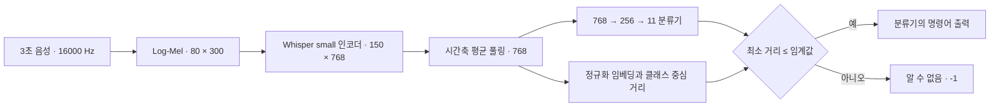
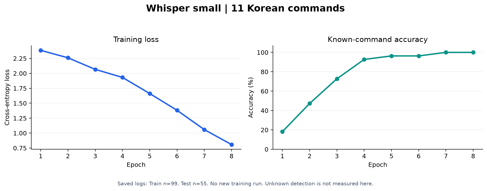

# Whisper Korean Commands

**3초 음성을 한국어 명령어 11개로 분류하고, 학습한 명령어와 거리가 먼 입력은 “알 수 없음”으로 처리하는 음성 인터페이스 프로젝트입니다.**

2025년 머신러닝 수업에서 진행한 「나만의 음성인식 모델 만들기」를 정리했습니다. Whisper의 다국어 사전학습 인코더를 활용하고 문자 생성 디코더 대신 명령어 분류기를 연결했습니다. 학습·분류 평가에서 거리 기반 입력 거절, 모바일 모델 내보내기, 앱 인터페이스 시연까지 확장했습니다.

[프로젝트 진행 내용](docs/PROJECT.md) · [실험 결과와 자료별 차이](docs/RESULTS.md) · [실행 안내](docs/REPRODUCIBILITY.md) · [핵심 노트북](notebooks/whisper_commands.ipynb)

## 구현한 내용

- **명령어 분류:** Whisper `small` 인코더 전체를 미세조정하고 평균 풀링과 2층 분류기를 연결
- **오디오 전처리 통합:** 16 kHz·3초 음성을 받아 모델 안에서 Log-Mel 특성 계산
- **Unknown 처리:** 학습 임베딩의 클래스 중심과 코사인 거리를 비교해 낯선 입력 거절
- **모바일 연동 실험:** TorchScript Lite 내보내기와 녹음·결과·기록 로그 UI 시연

저장소에는 학습·분류·거리 판단 코드와 설명을 담았습니다. 음성 파일, 학습 가중치, 앱 소스·APK, 발표자료 PDF는 포함하지 않습니다. 앱 기능은 발표자료에서 확인한 시연 내용을 문서로 정리했습니다.

## 구조



중심과의 거리는 **거절 여부**를 정합니다. 수락한 입력의 명령어는 분류기의 결과를 사용하며, 가장 가까운 중심의 라벨로 바꾸는 방식과는 다릅니다. 일반 문장을 받아쓰는 STT가 아니라 정해진 명령어 집합을 구분하는 분류 과제입니다.

## 명령어

| 코드 | 명령어 | 코드 | 명령어 |
|---|---|---|---|
| 1-1 | 불 켜 | 1-2 | 불 꺼 |
| 2-1 | 시작 해 | 2-2 | 정지 해 |
| 3-1 | 앞으로 가 | 3-2 | 뒤로 가 |
| 4-1 | 음악 틀어 | 5-1 | 전화 받아 |
| 6-1 | 모델 학습 | 7-1 | 데이터 준비 |
| 8-1 | 필터 적용 | | |

## 기록된 결과

| 항목 | 노트북의 저장 기록 |
|---|---|
| 모델 | Whisper small 인코더 + 평균 풀링 + 768→256→11 분류기 |
| 설정 | Adam, 학습률 1e-5, batch 16, 8 epoch |
| 자료 | Train 99개, Test 55개(명령어당 5개) |
| 알려진 명령어의 마지막 정확도 | **55/55, 100%** |
| Unknown 적용 평가 출력 | 알려진 명령어 46/55 정답, 9개 거절로 집계 |



**100%는 저장된 소규모 테스트의 명령어 분류 결과이며, 모르는 단어나 일반 환경의 성능을 뜻하지 않습니다.** Unknown 실제 정답 샘플은 0개여서 탐지율을 평가할 수 없습니다. 노트북에 서로 다른 실행 상태가 남아 있어 위 두 평가를 같은 조건의 재실행 결과라고 단정하지 않습니다.

발표자료는 8명·약 440개, 10 epoch와 화자별 Train 7명/Test 1명을 설명해 노트북 실행 기록과 다릅니다. 이를 하나의 실험으로 합치지 않고 [근거와 차이](docs/RESULTS.md)를 기록했습니다. 음성·학습 가중치가 없어 이번 정리에서 재학습하지 않았습니다.

## 실행하기

아래는 새로 학습하기 위한 안내입니다. 기존 학습 가중치는 포함하지 않습니다.

```bash
git clone https://github.com/danielkim717/Whisper-Korean-Commands.git
cd Whisper-Korean-Commands
python -m venv .venv
# Windows: .venv\Scripts\activate
# macOS/Linux: source .venv/bin/activate
python -m pip install -r requirements.txt
jupyter lab
```

FFmpeg를 설치해 명령 경로에서 사용할 수 있어야 합니다. [데이터 안내](data/README.md)에 맞춰 녹음 파일을 준비하고 [핵심 노트북](notebooks/whisper_commands.ipynb)을 순서대로 실행합니다. `KWS_DATA_DIR` 또는 `BASE_PATH`로 경로를 지정할 수 있습니다. 처음 모델 생성 시 Whisper 사전학습 가중치를 내려받습니다.

원래 셀 소스는 [보관 노트북](archive/ML_Project.ipynb)에 남겼습니다. 출력·메타데이터를 제거했으며, 원본은 누락 변수와 섞인 실험 상태 때문에 전체 순차 실행용이 아닙니다. 정리본 변경 범위와 확인하지 못한 사항은 [검증 문서](docs/REPRODUCIBILITY.md)를 참고하세요.

## 구성

```text
Whisper-Korean-Commands/
├── notebooks/whisper_commands.ipynb  # 전처리→학습→평가→거리 거절→저장
├── src/
│   ├── config.py                     # 라벨과 오디오 설정
│   ├── data.py                       # WAV 로드·라벨 매핑
│   ├── model.py                      # 인코더 분류 모델
│   └── unknown.py                    # 프로토타입과 거리 거절
├── archive/ML_Project.ipynb          # 출력·메타데이터를 제거한 원본 셀 소스
├── results/recorded_metrics.json     # 저장 로그의 집계 결과
├── docs/                            # 프로젝트·결과·검증 범위·출처
├── scripts/plot_recorded_results.py  # 저장 결과 그래프 생성
└── data/README.md                    # 개인 녹음 자료 배치 안내
```

## 의의와 후속 과제

사전학습 음성 표현을 명령어 분류에 활용하고, 어떤 입력이 와도 11개 중 하나를 출력하는 문제에 거리 기반 거절을 추가했습니다. 학습 결과를 앱의 녹음·판단·로그 흐름으로 연결하는 경험도 포함합니다.

다음 단계는 화자별 독립 검증, Unknown·잡음 평가, 학습·추론 전처리 통일, 별도 검증 자료에서의 임계값 선택, 모바일 지연시간·메모리 측정입니다. 거리나 Softmax 값을 보정된 정답 확률처럼 해석하지 않습니다.

## 작성자와 출처

**김태우 · 머신러닝 수업 프로젝트(2025)**

기반 기술: [OpenAI Whisper](https://github.com/openai/whisper), PyTorch, scikit-learn. 기반 모델의 라이선스와 공개 범위는 [출처 문서](docs/ATTRIBUTION.md)에 정리했습니다. 프로젝트 코드에는 별도 오픈소스 라이선스를 아직 지정하지 않았습니다.
